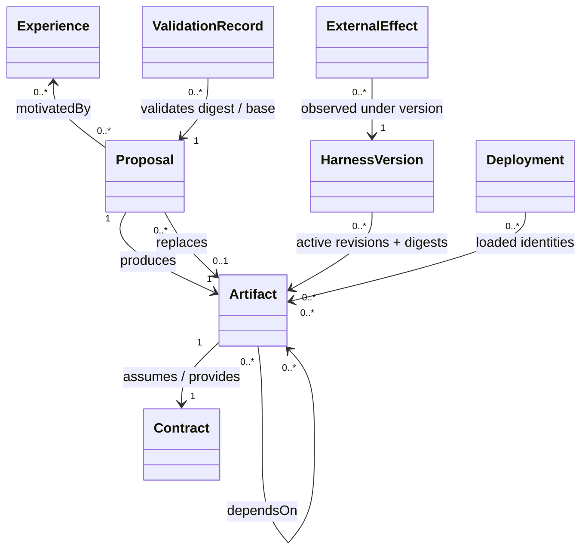

# HEARTNESS executable design

The dataclasses in `model.py` are the normative machine-readable metamodel.
Cardinalities below are structural; transition guards add well-formedness rules.

Artifact kinds: Memory, Skill, Prompt, Workflow, ToolConfig, AgentConfig,
ExecutableComponent. One tagged immutable Artifact type implements the variants.
Deployment and Run are typed dictionary relations rather than separate classes.
State is `(E,A,Q,V,X,W,K,D,L,F,log)` with proposal and validation maps Q/V,
accepted IDs X, withdrawn W, quarantine K, deployments D, loaded runs L and effects F.
Candidate/accepted/active/withdrawn/quarantined are derived statuses, not a single
enumeration: a revision can be accepted historically and currently withdrawn.

`derivedFrom` records supplied sources, not source causal contribution. Motivation
is retained in Proposal and exposure in Artifact. The external task scorer remains
outside mutable state. Authorized seeds are trusted import assertions supplied by
the host; proposer authorization/authentication is not implemented by this library.

## Operators, guards, postconditions and links

| Operator | Guard | State effect and trace |
|---|---|---|
| Experience | fresh experience ID | append task/run/outcome |
| Propose | fresh proposal/revision, typed artifact, known sources/dependencies/experience or authorized seed | immutable candidate and motivation; base snapshot stamp |
| Derive | Propose rules | retain source IDs and derivation kind |
| Merge | Propose + at least two distinct sources | retain every synthesis input |
| Edit | Propose + replaced revision is a source | new revision, previous content retained |
| Validate | unaccepted proposal exists | passed flag + exact content digest and base |
| Accept | passed exact validation, current base, safe lineage, consistent dependencies | persist revision and new immutable snapshot; mark replaced revision inactive |
| Withdraw | existing revision | global affected closure suspended; withdrawal monotone; new local snapshot |
| Quarantine | existing revision | suspend root and affected closure without deleting history |
| Rollback | existing snapshot; no forbidden lineage; contracts hold | restore exact active IDs, append snapshot and event; retain effects |
| Deploy/Reuse | known identities, safe closure, dependencies and contracts hold | deployment membership references same immutable revisions |
| Load | fresh run, content digests equal snapshot | run linked to version/active identities |
| Effect | known loaded run, fresh effect ID | retain external description and originating version |

All successful operators append an event chained to its predecessor. All rejected
operators restore the complete pre-state. A proposal-only policy cannot directly
modify the controller, final scorer, or stored revisions through this API. Direct
mutation of Python objects outside the API is a trust-boundary violation addressed
only insofar as observation reveals it. Concurrency is optimistic serialized
admission with base stamps; no distributed consensus or locking implementation.

## Properties

All properties are safety obligations `G(predicate)`. Bounded exploration checks
finite instances only; no unbounded proof or unconditional liveness claim.

| ID | Predicate | Evidence |
|---|---|---|
| P1 | every persisted artifact reaches experience or authorized seed | guards + Python audit/tests |
| P2 | active ∩ closure(withdrawn ∪ quarantine) = ∅ | guards, audit, finite projection |
| P3 | dependencies active and union of producer capabilities covers requirements | guards, audit; structural dependency projection |
| P4 | accepted/loaded content equals validated/snapshot content | digest guards/audit; Boolean validation projection |
| P5 | successful rollback restores exact recorded set; effects never removed | assignment, audit, tests; restoration modeled in projection |
| P6 | derivation endpoints exist and graph is acyclic | chronological immutable revisions + audit/tests |
| P7 | event/history prefix and persistent revision IDs never deleted | transition audit/tests |
| P8 | every registered deployment excludes affected withdrawn closure | suspension and deployment guard, audit, finite projection |
| P9 | accept base equals current version | stamp guard and transition audit; finite projection |
| P10 | event links and observed state digests agree with replay | chain audit and conformance monitor |

P3 is a declared syntactic capability contract, not proof of model-generated
content correctness. P4 Boolean projection is weaker than the digest property.
P10 cannot detect unlogged actions after the final observation. Complete capture,
trusted seed assertions, intact controller/observer and connected deployments are
preconditions for strong containment statements. Partial capture intentionally
violates the complete-capture assumption and underestimates true impact.
